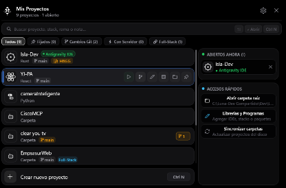

<p align="center">
  
</p>

<h1 align="center">Isla Dev</h1>

<p align="center">
  <b>Una Dynamic Island nativa para Windows, diseñada exclusivamente para desarrolladores.</b><br>
  Gestiona tus proyectos, servidores locales en vivo, ramas Git y flujos Full-Stack con cero fricción y máximo rendimiento.
</p>

<p align="center">
  
  
  
  
  
  
</p>

<p align="center">
  <a href="#-descargas">Descargar</a> •
  <a href="#-características-principales">Características</a> •
  <a href="#-atajos-de-teclado">Atajos de Teclado</a> •
  <a href="#-gestión-full-stack--servidores">Full-Stack & Servidores</a> •
  <a href="#-compilación-y-desarrollo">Compilación</a>
</p>

---

<p align="center">
  
</p>

---

## 💡 ¿Por qué Isla Dev?

Los desarrolladores alternamos constantemente entre terminales, editores de código (VS Code, Antigravity IDE, Cursor), servidores de desarrollo (`localhost:5173`, `localhost:3000`) y comandos de Git. 

**Isla Dev** traslada la experiencia de la **Dynamic Island** al escritorio de Windows en una aplicación **100% nativa en Rust**:
- **Sin Electron ni Chromium:** Consume menos de 20 MB de RAM y el ejecutable pesa ~1.4 MB.
- **Gráficos fluidos en Direct2D:** Renderizado por hardware con físicas de resortes reales (*spring physics*), curvas bezier fluidas y tipografía nítida en monitores de alta densidad (HiDPI).
- **0.0% de CPU en reposo:** Permanece discretamente en el borde superior de tu pantalla sin interferir con tu flujo de trabajo.

---

## ⚡ Características Principales

### 🏝️ 1. Interfaz Dinámica estilo Apple
* **Gota en Reposo:** Una pequeña píldora oscura centrada en la parte superior de tu pantalla que responde suavemente al cursor con brillo y animación expansiva.
* **Barra de Progreso Luminosa:** Al clonar un repositorio, crear un proyecto o hacer `git push`, el borde curvo inferior de la gota se ilumina progresivamente indicando el avance en segundo plano.
* **Micro-Badges y Reducción de Ruido Visual:** Diseño inspirado en *Linear* y *Raycast*. Las acciones de cada fila se revelan suavemente al pasar el ratón (*hover*), manteniendo la lista limpia y legible.
* **Scrollbar Ultra-fino (3 px):** Indicador visual minimalista para navegar fluidamente entre decenas de proyectos.

### ⚡ 2. Servidores en Vivo ("Live Dev Servers") y Control de Puertos
* **Punto de Estado Luminoso:** Si tienes uno o más servidores corriendo (`:5173`, `:3000`, `:8000`, etc.), la gota superior muestra puntos verdes simétricos indicando actividad.
* **Botón Play / Stop directo (`▶` / `■`):** Inicia o detiene servidores de desarrollo sin necesidad de abrir ventanas de consola adicionales.
* **Badges de Puertos con 1-Click:** Haz clic en `:5173` para abrir la URL en tu navegador; o haz clic en `×` para matar procesos colgados que ocupen un puerto local.
* **Visualizador de Logs y Errores:** Si un comando falla (`npm error`, puerto en uso o dependencia faltante), la isla extrae el motivo exacto y te permite abrir el registro completo en la terminal con un clic.

### 🔗 3. Combos Full-Stack (Frontend + Backend)
* **Detección Automática:** Identifica repositorios que contienen tanto frontend como backend (subcarpetas `frontend/` + `backend/`, `client/` + `server/`, `web/` + `api/`) o proyectos vinculados manualmente.
* **Control Selectivo:** Puedes iniciar solo el Frontend, solo el Backend o lanzar **ambos servidores en simultáneo** con 1 clic ("Combo Full-Stack").

### 📥 4. Clonar Repositorios desde el Portapapeles (1-Click Git Clone)
* Copia cualquier enlace de GitHub (`https://github.com/usuario/repositorio`) y abre la isla.
* Aparecerá automáticamente la tarjeta **"📥 Clonar repo del portapapeles"**. Con un solo clic lo descarga en tu carpeta raíz, detecta sus dependencias, instala los paquetes necesarios y te lo abre listo en tu IDE preferido.

### 📦 5. Detección Inteligente de Gestores de Paquetes
* Detecta automáticamente si tu proyecto usa:
  - ⚡ **Bun** (`bun.lockb` / `bun.lock`) ➔ Ejecuta `bun run dev`
  - 🦄 **pnpm** (`pnpm-lock.yaml`) ➔ Ejecuta `pnpm dev`
  - 🧶 **Yarn** (`yarn.lock`) ➔ Ejecuta `yarn dev`
  - 📦 **npm** (`package-lock.json`) ➔ Ejecuta `npm run dev`

### 🗂️ 6. Sección "Abiertos Ahora" y Prevención de Ventanas Duplicadas
* **Detección en Tiempo Real:** Reconoce al instante qué proyectos tienes abiertos y en qué programa (**Antigravity IDE**, **VS Code**, **Cursor**, **Windsurf**, **IntelliJ**, **PyCharm**, **Terminal**, etc.).
* **Anti-duplicados:** Si intentas abrir un proyecto que ya está corriendo en tu pantalla, Isla Dev enfoca y maximiza la ventana abierta existente en lugar de abrir una segunda instancia pesada.

### 🔍 7. Buscador Instantáneo ("Spotlight") y Chips de Filtro
* Escribe directamente para buscar por nombre, lenguaje, tecnología o rama Git.
* **Filtros Rápidos por Chips:**
  - `Todos`: Tu catálogo completo de proyectos.
  - `📌 Fijados`: Proyectos prioritarios o frecuentes.
  - `● Cambios Git`: Proyectos con código modificado sin guardar en commit.
  - `⚡ Con Servidor`: Proyectos con servidores locales en ejecución.
  - `🔗 Full-Stack`: Proyectos con arquitectura dual Frontend + Backend.

### 📝 8. Mini-TODO / Notas por Proyecto
* Guarda recordatorios rápidos en cualquier proyecto (ej. *"Falta conectar pasarela de pagos"*, *"Revisar rama de staging"*). Se muestran como micro-badges y también son indexados en el buscador.

### 🐙 9. Git & GitHub Integrado
* Muestra la rama activa (`⎇ main`) mediante lectura instantánea de `.git/HEAD` en 0 ms con icono vectorial Direct2D.
* **Modal Visual de Git:** Realiza `git add -A`, crea commits con mensajes limpios, genera repositorios en GitHub mediante GitHub CLI (`gh repo create`) y sube cambios (`git push`) sin salir de la isla.

### 🛡️ 10. Prioridad Z-Order y Soporte Multi-Monitor
* **Siempre Visible:** Gracias a su algoritmo de gestión Z-Order, permanece visible por encima de la barra de tareas superior de Windows 11 sin robar el foco del teclado.
* **Auto-ocultamiento Inteligente:** Se oculta automáticamente cuando abres un videojuego o reproduces un video en pantalla completa exclusiva.

---

## ⌨️ Atajos de Teclado

| Atajo | Acción |
| :--- | :--- |
| `Ctrl + Alt + Espacio` | Abrir / contraer la Isla desde cualquier aplicación |
| `↑` / `↓` | Navegar por la lista de proyectos filtrados |
| `Enter` (`↵`) | Abrir el proyecto seleccionado en el IDE por defecto |
| `Ctrl + 1` .. `Ctrl + 9` | Abrir directamente los primeros 9 proyectos de la lista |
| `Ctrl + N` | Iniciar el asistente para crear un nuevo proyecto |
| `Esc` | Regresar a la vista anterior o minimizar la isla a la gota |

---

## 🚀 Lanzadores de IDE Compatibles

Isla Dev se integra de forma transparente con tus herramientas habituales:
- **Google Antigravity IDE** (por defecto)
- **Visual Studio Code**
- **Cursor**
- **Windsurf**
- **Zed**
- **JetBrains IDEs** (IntelliJ IDEA, WebStorm, PyCharm, Rider)
- **Windows Terminal** / Consola de Comandos
- **Explorador de Archivos de Windows**

*(Puedes añadir cualquier ejecutable o comando personalizado desde la sección "Personalizar").*

---

## 📦 Descargas

Encuentra los binarios precompilados listos para usar en la carpeta [`dist/`](dist/):

* **Instalador Oficial:** [`IslaDev-Setup-0.1.0.exe`](dist/IslaDev-Setup-0.1.0.exe)
  * No requiere permisos de administrador.
  * Crea accesos directos con el icono oficial en el Escritorio y Menú Inicio.
  * Opción para iniciar automáticamente con Windows.
* **Ejecutable Portable:** [`isla-dev-portable.exe`](dist/isla-dev-portable.exe)
  * Sin instalación. Ejecuta y úsalo desde cualquier carpeta o pendrive.

---

## 🛠️ Compilación y Desarrollo

### Requisitos Previos
1. **Rust (toolchain estable):**
   ```powershell
   rustup default stable-x86_64-pc-windows-gnu
   ```
2. **Inno Setup 6 (opcional, solo para generar el instalador `.exe`):**
   Descargable desde [jrsoftware.org](https://jrsoftware.org/isdl.php).

### Pasos para compilar:

```powershell
# 1. Clonar el repositorio
git clone https://github.com/IsAndresL/Isla-Dev.git
cd Isla-Dev

# 2. Compilar en modo Release optimizado
cargo build --release --target x86_64-pc-windows-gnu

# 3. Incrustar el icono oficial en el ejecutable
python logo/embed_icon.py target/x86_64-pc-windows-gnu/release/isla-dev.exe

# 4. (Opcional) Compilar el instalador oficial
& "$env:LOCALAPPDATA\Programs\Inno Setup 6\ISCC.exe" installer/isla.iss
```

---

## 📁 Arquitectura del Código

El proyecto está diseñado bajo una arquitectura modular en Rust:

```
src/
├── main.rs      # Punto de entrada, ventana Win32, prevención de doble instancia y mensaje loop
├── app.rs       # Estado reactivo, físicas de resortes, manejo de temporizadores y teclado/ratón
├── views.rs     # Renderizado Direct2D: vistas compacta, expandida, ajustes y barra de progreso
├── modals.rs    # Modales interactivos: Asistente de creación, Git & GitHub, Mini-TODO y editores
├── actions.rs   # Procesos en segundo plano: Git, detección de puertos, full-stack y APIs Win32
├── gfx.rs       # Motor gráfico Direct2D, DirectWrite, trazado de vectores e iconos de tecnologías
└── config.rs    # Parser y serializador de configuración persistente (%APPDATA%\IslaDev\config.toml)
```

---

## 📄 Licencia

Este proyecto está bajo la licencia **MIT**. Consulta el archivo [LICENSE](LICENSE) para más detalles.

---

<p align="center">
  Hecho con ❤️ para la comunidad de desarrolladores por <b>Ing. Andres Luna</b>
</p>
